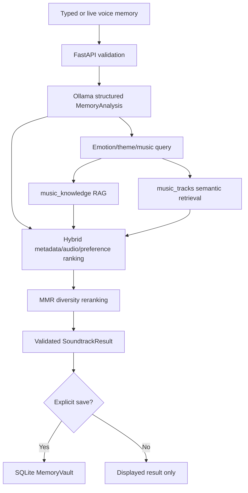

# Architecture

## Current architecture

The application is a local-first modular monolith. Streamlit and FastAPI are presentation boundaries, while `modules/soundtrack_service.py` owns the shared domain orchestration.

```text
Streamlit UI
   |
   v
Soundtrack orchestration (currently in app.py; extraction planned)
   |
   +--> MemoryAnalyzer ----> Ollama (local, optional fallback)
   +--> RAGEngine ---------> Sentence Transformers + ChromaDB (local)
   +--> MusicCatalogue ----> normalized local catalogue / approved imports
   +--> RecommendationEngine (weighted signals + RAG context + diversity)
   +--> ExplanationGenerator (grounded LLM explanation + deterministic fallback)
   +--> MemoryVault --------> SQLite (local user data)
```

## Domain contracts

- `MemoryAnalysis` is the validated interpretation of a memory. It describes emotions and musical direction; it is not a psychological diagnosis.
- A catalogue track uses nullable metadata and explicit provenance. Missing artwork or playback URLs are represented as unavailable, never fabricated.
- `TrackRecommendation` contains the selected metadata, a bounded score, and an explanation based only on known signals.
- `SoundtrackResult` is the stable boundary between orchestration and presentation.

## Ranking pipeline

1. Validate memory input.
2. Analyze it with the configured local model and validate structured output.
3. Build a retrieval query from emotions, themes, context, and musical characteristics.
4. Retrieve semantic knowledge and normalize the vector-store distance into `[0, 1]`.
5. Score catalogue candidates across mood, genre, language, theme, instruments, audio characteristics, personal preferences, and RAG-derived topic signals.
6. Renormalize weights when metadata is missing.
7. Apply diversity reranking to reduce repeated artists and near-identical tag sets.
8. Generate grounded per-track and overall explanations.
9. Persist only when the user explicitly saves.

## Design principles

- **Local by default:** no paid API or cloud inference is required.
- **Honest availability:** metadata, artwork, preview, and full playback are separate capabilities.
- **Safe rendering:** dynamic user and catalogue content uses native Streamlit rendering, never interpolated HTML.
- **Graceful degradation:** analysis, embeddings, and explanation services fail with actionable UI messages; deterministic catalogue ranking remains testable independently.
- **CPU-first:** defaults target CPU inference and avoid CUDA-only dependencies.
- **Migration seam:** the domain modules are independent of Streamlit state. A future FastAPI layer should call these services and reuse the same Pydantic schemas.

## Future service boundary

```text
React/Vite client  <---- JSON ---->  FastAPI API
                                      |
                                      +--> SoundtrackService
                                      +--> SpeechService (optional faster-whisper)
                                      +--> MemoryAnalyzer / RAG / Catalogue / Ranker
                                      +--> SQLite + ChromaDB
```

The migration should happen after the core contract and deterministic tests are stable; otherwise the UI rewrite would duplicate unresolved domain bugs.

## Canonical request flow

React/Vite is the canonical product frontend. The single `memory` textarea is shared by typed input and live browser speech recognition. The final text follows the same FastAPI path:



`music_knowledge` stores conceptual music and cultural context. `music_tracks` stores real catalogue track profiles. Track-vector failures fall back to the normalized catalogue.

The service reuses the RAG Sentence Transformer instance for track queries, keeps explanations deterministic by default, and logs analysis, retrieval, and ranking timings. See `PERFORMANCE.md`.

Browser speech recognition is not guaranteed to be local and is disclosed in the UI. Typed text follows local FastAPI/Ollama processing. The optional faster-whisper endpoint remains available as a local fallback; raw recordings are not persisted.
